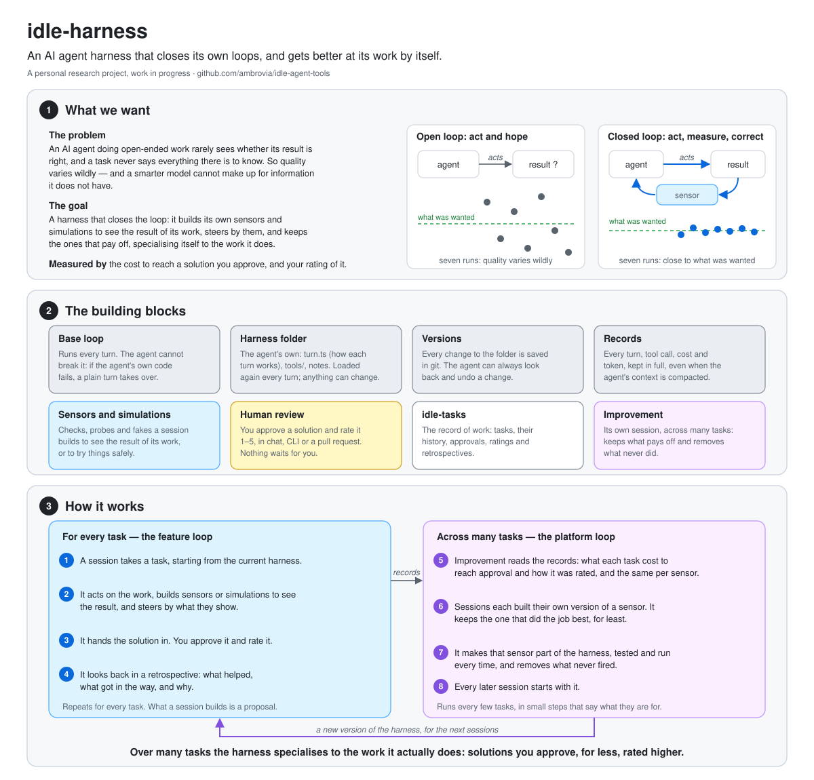

# How idle-harness works

*A short tour. The intent is in [INTENT.md](../../idle-harness/INTENT.md), the design in [base.md](base.md) and [analytics.md](analytics.md), and what the evals found in [evals/README.md](../../idle-harness/evals/README.md).*

**What it is for.** When an LLM builds something open-ended whose result is hard to check, quality varies wildly. Models keep getting better at the skills; no model can make up for information it does not have. idle-harness is a harness that closes its own loops: it builds the tools that let it see the result of what it does, so the LLM, as the controller, can steer toward what was actually wanted even when the task leaves things out. Where it cannot try things on the real thing, it builds a simulation and keeps checking it against reality.

**The base** is the part the harness cannot break. It runs the loop, saves every change to the harness folder as a version in git, and appends every turn to a session record: each call, its cost and its tokens. A harness that breaks itself still finishes its work on the plain turn, notices, and mends itself or goes back. A new harness is an empty folder and works from the first message.

**The harness** is that folder: its own `turn.ts`, which receives and returns the whole context, its tools in `tools/`, and whatever else it writes for itself. It is loaded again every turn, so it can change anything about how it works, down to its inner structure.

**The feature loop** is a working session doing a task. Along the way it builds what it needs to see its results: checks, probes, fakes of services it must not touch. It ends with a retrospective and asks the human for review. What it builds stays its own: a proposal for the platform loop to take up, so one task does not reshape the harness.

**The platform loop** is improvement, a session of its own that runs across many tasks. It reads two numbers per task — the cost to reach an approved solution and the human's rating of it — and the same per version of every sensor and simulation the sessions built. It keeps the version that did the job best for least, gives it checks and wires it into the turn where that pays, and prunes what never fires. Each change says what it is for, and the tasks after it show whether it made the work better, faster or cheaper.

**The human** advises and nothing waits for them. They approve a solution and rate it 1 to 5, in the chat, on the command line or on a pull request. Those ratings, the tasks and their retrospectives live in idle-tasks, the shared record of work.

## Where it stands

Built: the base loop, versions, records, tools as files, a crude context fit, task attribution and the analytics of control loops (`idle-harness stats`), and eighteen evals that run sandboxed. The evals so far show that a session closes every loop whose feedback arrives within it. The platform loop can only pay off where feedback spans sessions, so the next work is long, real tasks and an analytics system that learns from them.

Not built yet: approval and rating in idle-tasks, the review step, the compaction default from the [compaction report](../../reports/Context%20compaction%20in%20agent%20harnesses.md), session-local harness copies, change declarations, automatic improvement, and replay of one turn.
